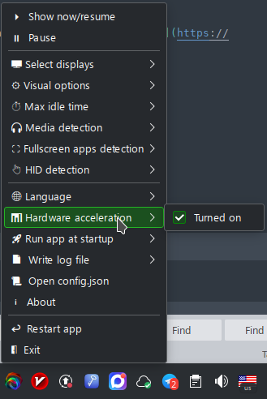

# 
Famous Windows-like Ribbons Screensaver rewritten for multi-platform support with **Tauri 2 (Rust)**.

<table>
  <thead>
    <tr>
      <th>Style</th>
      <th>Example</th>
    </tr>
  </thead>
  <tbody>
    <tr>
      <td><strong>New modern</strong></td>
      <td></td>
    </tr>
    <tr>
      <td><strong>Classic polygon</strong></td>
      <td></td>
    </tr>
  </tbody>
</table>

## Minimum OS requirements

- macOS 14.6+
- Windows 10+
- Linux with a modern kernel (>= 6.x) and PipeWire/PulseAudio

## Download and install

Go to the landing page https://ribbons.drlight.fun, download the latest build for your platform and follow the installer.

## Settings

Settings are stored in `config.json` in the same per-user locations as before:

- Windows: `%AppData%\Ribbons Screensaver`
- Linux: `~/.config/Ribbons Screensaver`
- macOS: `~/Library/Application Support/Ribbons Screensaver`

Development builds use a `-dev` suffix.

## Linux notes

- Fullscreen detection uses **wctx** on Wayland and **xprop** on X11. On Wayland, install `wctx` and enable its user daemon. On X11, install `xprop`.
- Idle/user activity is read from `/dev/input/event*` (evdev), which is reliable on KWin/Wayland where `ScreenSaver.GetActiveTime` often returns 0. Add the user to the `input` group and log in again:
  `sudo usermod -aG input $USER`.
- Screen lock/suspend events use freedesktop DBus services (`org.freedesktop.ScreenSaver`, `org.freedesktop.login1`). If evdev is unavailable the app falls back to DBus idle time and simply skips activity-based auto-stop until input becomes readable.
- System audio detection uses `parec` against the default monitor source (`@DEFAULT_MONITOR@`).
- On Wayland, support depends on the compositor. KDE Plasma and GNOME are the tested environments.

### <ins>So for all the platforms make sure to disable "native" screensaver to prevent conflicts!</ins>

After app startup check it's settings in tray menu:


## Building from source

Install the platform build dependencies. On Arch/CachyOS, Debian/Ubuntu the helper script covers the common packages:

```bash
chmod +x ./prepare.sh
./prepare.sh
```

Then:

```bash
npm run dev        # development
npm run build      # platform bundles
npm run help       # all build commands and paths
```

Build helpers from the original project are still available:

```bash
npm run build-json
npm run build-deb
npm run build-rpm
npm run build-AppImage
npm run build-targz
npm run build-exe
npm run build-msi
npm run build-zip
npm run build-dmg
npm run build-zip-mac
npm run build-linux   # rpm + deb + tar.gz + AppImage
npm run build-win     # zip + msi + nsis
npm run build-mac     # dmg + zip
```

`npm run block` creates `UPDATE_BLOCK` before a build; `npm run unblock` removes it.

### Updater signing

Tauri verifies update artifacts. The repository ships a placeholder key so development builds work without signing. For production self-updates:

1. Generate a key pair with `npx @tauri-apps/cli signer generate`.
2. Replace `plugins.updater.pubkey` in `src-tauri/tauri.conf.json`.
3. Set `TAURI_SIGNING_PRIVATE_KEY` (or `TAURI_SIGNING_PRIVATE_KEY_PATH`) (and its password `TAURI_SIGNING_PRIVATE_KEY_PASSWORD`) when building.
4. Publish `latest.json` and signed artifacts with each GitHub release.

Until then, the version-check dialog still works and the **Yes** button opens the release page.

## Architecture

```
ui/                 # HTML/CSS/JS renderer (ribbon engines, settings, update dialog)
src-tauri/src/      # Rust backend
  config.rs         # JSON store + defaults (same config.json keys)
  windows.rs        # screensaver/settings windows, fullscreen, options IPC
  tray.rs           # tray icon and dynamic menu
  monitor.rs        # idle/fullscreen/activity loop
  media.rs          # system audio RMS detection
  active_window.rs  # cross-platform active-window/fullscreen detection
  system_events.rs  # lock/suspend listeners and resume watchdog
  autostart.rs      # startup integrations and app restart
  updates.rs        # GitHub version checks and updater dialog
legacy-electron/    # original Electron main process, kept for reference
```

The renderer talks to Rust through `ui/tauri-ipc.js`:

- `send(event, payload)` → `renderer_message` command.
- `on(event, handler)` → Tauri event listener.
- Backend → window events: `send-options`, `send-stop`, `send-pause`, `show-close-btn`, `ribbons-settings-load`.

## Special thanks to

- [madve2](https://github.com/madve2) for the [electron-screensaver-seed repo](https://github.com/madve2/electron-screensaver-seed) that was partly used to create the initial Electron app.
- [fadyehabamer](https://github.com/fadyehabamer) for the [Ribbons-Screensaver repo](https://github.com/fadyehabamer/Ribbons-Screensaver) that is the basis for the graphics.
- [CilginSinek](https://github.com/CilginSinek) for [electron-native-screenshare](https://github.com/CilginSinek/electron-native-screenshare), which inspired the system-audio detection approach.

All rights belong to their authors.
